## About Me

I'm a second-year B.E. Computer Science and Engineering student at **Kongunadu College of Engineering and Technology** (Trivandrum, India based), building practical AI software in **Python** and **Java**. I'm especially interested in **Generative AI**, **UI/UX Design** and **AI Agent Development**.

I completed a Generative AI & Agentic AI internship covering LLMs, RAG, prompt engineering, LangChain, LangGraph and vector databases, and I'm now looking for **software engineering internships and entry-level roles**.

## Achievements

| | |
|---|---|
| 🏆 **Chandigarh Police Hackathon 2026** | Team **DRACARYS!** received a ₹50,000 consolation prize for a Biochemical Rapid/Spot Testing Kit for Synthetic Drug Detection. |
| 🌍 **HemoConnect** | Selected as an **SDG project** at college. |

## Experience

**Generative AI & Agentic AI Intern** · DigiDARA Technologies Pvt. Ltd. with Kongunadu College of Engineering and Technology · *Jan 2026 – Mar 2026*

- Completed a 3-month course-cum-internship in Generative AI & Agentic AI.
- Worked on machine learning, deep learning, NLP, LLMs, RAG, prompt engineering, fine-tuning, vector databases, LangChain, LangGraph, MCP and AI agent development.
- Built real-world AI projects: **Alumni Connect AI Agent** and **Canteen AI Agent**.

## Selected Projects

| Project | What it does |
|---|---|
| **HemoConnect**   *Aug – Sep 2026* | Blood donor and blood bank coordination platform connecting people who need blood with donors, verified hospitals and blood banks. Includes donor registration and profiles, hospital and blood-bank search, live database integration, chat and calling, plus AI-assisted donor recommendations, eligibility prediction, blood demand forecasting and blood-group checking. |
| **AI-Powered Voice Assistant with Object Detection**   *Oct – Dec 2025* | Bilingual (Tamil and English) voice assistant with human-like voice interaction and intelligent responses, plus real-time object recognition using computer vision concepts. |
| **Canteen AI Agent**   *Jan – Mar 2026* | Responsive frontend for an AI-powered canteen system covering food browsing, ordering and an AI assistant for canteen queries. I worked as frontend and interface developer. |
| **Alumni Connect AI Agent** | Generative AI assistant that supports alumni communication and engagement. |

More work lives in my [repositories](https://github.com/kjagadheesh48-alt?tab=repositories).

## Skills

| Category | Skills |
|---|---|
| **Programming** | Python, Java |
| **AI & Machine Learning** | Generative AI, LLMs, Prompt Engineering, RAG, Vector Databases, Fine-Tuning, Machine Learning, Deep Learning, NLP, Computer Vision |
| **Agentic AI** | LangChain, LangGraph, Model Context Protocol (MCP) |
| **Other** | UI/UX Design, Application Development, Networking Fundamentals, Cybersecurity Basics, Team Collaboration |

## Certifications

- Cisco Networking Academy: CCNA, Introduction to Networks (Feb 2026 – Aug 2026)
- Generative AI & Agentic AI, DigiDARA Technologies Pvt. Ltd. (Jan 2026 – Mar 2026)
- Cybersecurity & Essential Security Skills, Xplore Intellects Pvt. Ltd. (May 2026)
- UI/UX Design Fundamentals and Beyond, Xplore Intellects Pvt. Ltd. (Nov 2025)

## GitHub Activity

